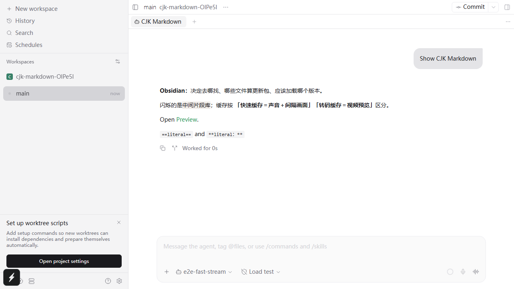
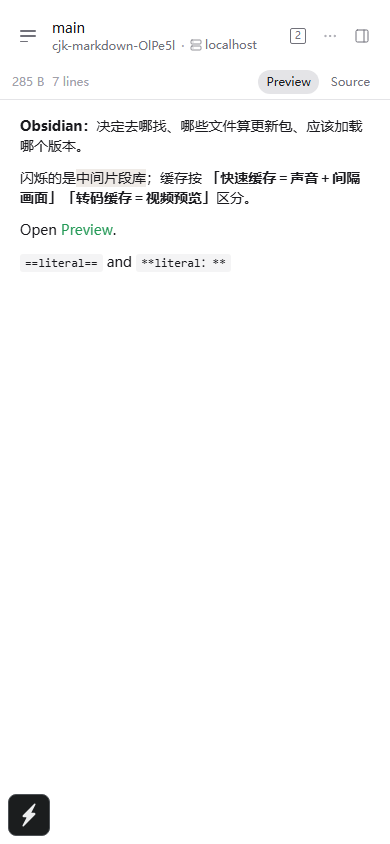

# CJK emphasis and inline highlights

Branch: `moy/markdown-cjk-highlight`, based on `origin/local/all-feats`.

## Rendering

The regression first failed against the previous WASM: `**Obsidian：**决定` was one literal Text node. The combined highlight and quoted-bold example also failed before enabling highlights and rebuilding the parser.

The final renderer unit file passes all 165 tests. It exercises the installed WASM, source adaptation, CJK strong/emphasis, nested highlights, literal code and escapes, and dark/light/muted highlight colours.

The targeted browser E2E passes with an isolated daemon and Metro, including normal teardown:

```text
ok 1 [browser] renders CJK emphasis and highlights in chat and file preview (8.9s)
1 passed (58.1s)
```





The screenshots and E2E cover the two reported strings, adjacent prose, semantic `strong`/`mark` elements, a file-preview link and literal delimiters in inline code. Native selection and streaming have not been tested on a device.

## Checks and limits

- The first CI run failed 15 jobs. In `app-tests`, 68 suites could not import the rebuilt WASM because Vite's CommonJS-to-ESM adapter matched only the old single-quoted trailer. This was introduced by this PR, despite the direct parser tests passing. The adapter now accepts either quote style. `vitest-environment.test.ts` reproduces the old failure through the shipped `lib/module` import and passes after the fix (4 tests passed). CI must be rerun before claiming the regression is resolved there.
- `npm run build:app-deps` passed.
- `npm run format` and targeted `npm run lint -- <changed TS files>` passed.
- `npm run typecheck` passed before Expo generated `.expo/types/router.d.ts`. After browser E2E, the same command reports the existing `src/navigation/settings-navigation.ts:64` string-to-Href error. That source file is identical to HEAD; no routing changes are included. The pre-commit typecheck job is excluded for this draft because the known failure is recorded, not fixed by this PR.
- npm and pnpm patches apply to the pristine pinned npm package. `pnpm install --lockfile-only --frozen-lockfile --ignore-scripts` passes. Only the Markdown patch hash changes in the lockfile.
- The existing shared-renderer/file-link E2E fails on `assistant-message p div` (expected 0, received 2). It fails identically with the previous HEAD WASM; the file-link renderer's nested View is unchanged. This failure is not claimed as a passing regression check.
- One initial target E2E passed its assertions but failed Windows process teardown. Subsequent target runs exit successfully. Raw command output is retained beside this note.

## Parser cost

A local Node/WASM microbenchmark parsed a 4,620 UTF-16-character mixed Markdown sample 200 times per round, five rounds per version. Highlights were disabled on both sides to isolate the parser change. Before: 66.42, 65.90, 69.13, 64.71, 58.62 ms. After: 67.19, 61.07, 69.05, 73.22, 63.73 ms. Median cost changed from 65.90 to 67.19 ms (about 2%). This does not establish UI or device performance.

## Platforms

| Platform                 | Coverage                                                          |
| ------------------------ | ----------------------------------------------------------------- |
| Web Chromium on Windows  | Real chat and file preview, wide and compact layouts              |
| iOS / Android            | Not tested; C parser changes require rebuilding the native client |
| Electron / macOS / Linux | Not tested                                                        |

Both the C parser and the two shipped WASM copies are patched. WASM was rebuilt with Emscripten 4.0.22, using the package build flags and `SINGLE_FILE_BINARY_ENCODE=0` to retain base64 embedding. Existing package patch sections outside the C parser and WASM artifacts are preserved.
